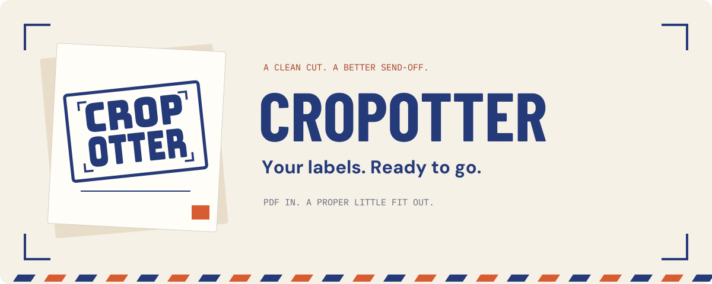
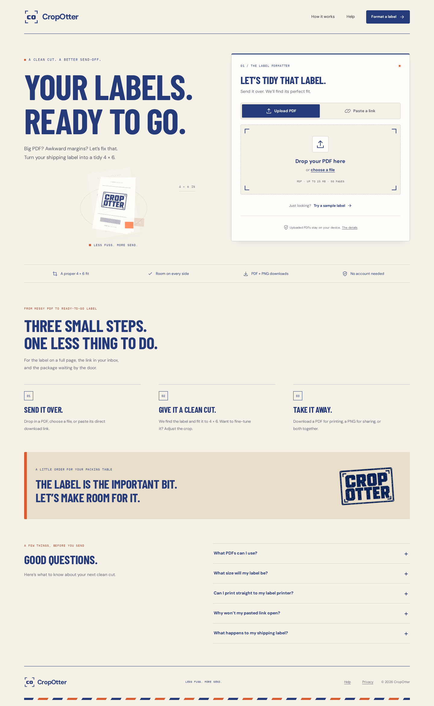
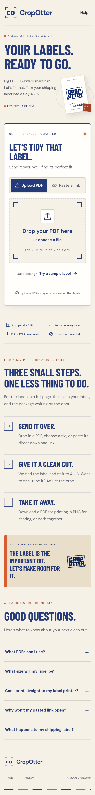

<p align="center">
  
</p>

<p align="center">
  <a href="https://github.com/mrdewclau/cropotter/actions/workflows/ci.yml"></a>
  <a href="LICENSE"></a>
  
  
</p>

<p align="center">
  <strong>A proper little fit for your shipping labels.</strong><br />
  Drop in a PDF or paste its link. Give it a clean cut. Download a ready-to-print PDF or PNG.
</p>

<p align="center">
  <a href="#run-locally">Run locally</a> · <a href="HANDOFF.md">Pick up the work</a> · <a href="brand/README.md">Brand system</a> · <a href="deploy/README.md">Deploy</a> · <a href="docs/roadmap.md">Roadmap</a>
</p>

---

CropOtter turns oversized or awkward shipping-label PDFs into portrait **4 × 6 inch labels with at least ⅛ inch of white space on every side**. It preserves proportions and asks for review when a crop is uncertain. Exported PDFs contain only the visible label pixels at 300 DPI, so cropped-out source content, hidden PDF objects and source attachments are not carried into downloads.

Live at **[cropotter.com](https://cropotter.com)** on DigitalOcean. One viewport-fitting app shell: upload, review and download, with a contained animated guide. No scrolling landing page. See [deployment verification](docs/deployment-2026-10-21.md) or [HANDOFF.md](HANDOFF.md) to continue development.

<table>
  <tr>
    <td width="73%"></td>
    <td width="27%"></td>
  </tr>
</table>

## A clean cut, start to finish

- **Send it over.** Upload a PDF, drag and drop it, paste a public HTTPS PDF link, or try the included sample.
- **Fine-tune the fit.** Automatic label detection, real PDF previews, crop movement/resizing, multiple regions, page skipping and rotation. Uncertain output stays behind a review acknowledgement.
- **Take it away.** Download the combined PDF, individual PNGs at 203 or 300 DPI, or a ZIP with the PDF and every label image.
- **Use your screen.** Fluid phone, tablet and desktop layouts, keyboard controls, touch controls, accessible crop sliders, and reduced-motion support.
- **Keep it simple.** Uploaded files are processed in the browser. Direct links pass through a bounded server fetch. No accounts, database, label history or analytics.

The contained Three.js demonstration explains full-page PDF → crop → finished label, with Pause/Play and a static fallback. Fonts, PDF workers and decoding assets are served locally. Exported shipping labels contain no CropOtter branding.

## Use with an AI agent

[Install the Claude Desktop extension for macOS](https://github.com/mrdewclau/cropotter/releases/download/claude-desktop-v0.1.2/cropotter-0.1.2-macos-universal.mcpb), [download the local MCP package and Agent Skill](https://cropotter.com/agents/), or read the [agent guide](docs/agent-tools.md). The [desktop release and submission packet](https://github.com/mrdewclau/cropotter/releases/tag/claude-desktop-v0.1.2) include checksums and tested limitations.

| Route                    | Execution                                        | Requirements                                                                                                                                                                                                                                                  |
| ------------------------ | ------------------------------------------------ | ------------------------------------------------------------------------------------------------------------------------------------------------------------------------------------------------------------------------------------------------------------- |
| Claude Desktop extension | Local bundled runtime                            | macOS 13.5+, Apple Silicon or Intel; open the unsigned `.mcpb`, select a private workspace and save PDFs there. No separate Node installation. Outputs are local files; this tested host does not attach download cards.                                      |
| Native OpenAI plugin     | Caller's supported ChatGPT Chat/Work environment | Skills-only package; Node 24+, npm and local execution. Actual desktop discovery and ChatGPT web import, sample/attached-PDF conversion and downloadable files verified. Mobile remains unverified. See [setup and acceptance](docs/openai-plugin/README.md). |
| WebMCP                   | Existing website's browser engine                | A browser/agent supporting top-level WebMCP tools; upload a PDF in the page, then inspect, configure, review and download through its tools.                                                                                                                  |
| Local MCP                | Caller-controlled Node process over stdio        | Node 24+, npm/native canvas support and explicit local file access. Tools analyze/convert PDFs and expose only generated output resources.                                                                                                                    |
| Agent Skill              | Caller's existing local or sandbox runtime       | Complete skill ZIP, Node 24+ and local process/file support; bundles the same engine, not model-generated cropping code.                                                                                                                                      |

No hosted conversion worker, database, artifact storage subscription or model API is required. Existing website/distribution bandwidth and the caller's model/runtime usage still apply. Uncertain crops retain human review; filenames are editable; PDF/PNG/ZIP files remain unbranded. Host-specific attachment presentation and feature availability vary. Browser blob links work only inside the current page.

## Run locally

Install **Node 24 or newer**, then:

```sh
git clone https://github.com/mrdewclau/cropotter.git
cd cropotter
npm ci
npm run dev:web
```

Open **http://127.0.0.1:4174**. Upload your own label or choose **Try a sample label**. The sample uses fictional recipient data.

For the production service:

```sh
npm run build:web
npm run start:web
```

The default port is **8080**; override it with the `PORT` environment variable. `/healthz` reports readiness. See [deployment instructions](deploy/README.md) for Docker, DigitalOcean and GoDaddy DNS.

## Under the paper

| Part          | Location                                       | Job                                                                        |
| ------------- | ---------------------------------------------- | -------------------------------------------------------------------------- |
| Website       | [`apps/web`](apps/web)                         | React, TypeScript, Vite, Three.js, crop editor and downloads               |
| Shared engine | [`packages/engine`](packages/engine)           | PDF analysis, selection, preparation, barcode evidence and raster export   |
| Link service  | [`apps/web/server`](apps/web/server)           | HTTPS-only PDF fetching, DNS pinning, redirect checks and bounded delivery |
| Production    | [`Dockerfile`](Dockerfile), [`deploy`](deploy) | Non-root, standalone Node service; no database required                    |
| Identity      | [`brand`](brand)                               | Approved board, editable source, marks, fonts and design tokens            |
| Decisions     | [`docs`](docs)                                 | Architecture, workflows, printer research and verification                 |

See the [engine API and CLI guide](docs/engine-api.md), [pipeline architecture](docs/proposed-pipeline.md), [user journey](docs/diagrams/README.md) and [MUNBYN ITPP130B research](docs/munbyn-itpp130b-research.md).

## Check the work

```sh
npm run typecheck
npm run typecheck:web
npm test
npm run test:web
npm run test:local
npm run test:agents
npm run verify:local:packed
npm run verify:agents
npm run fixtures
npm run build:web
npx playwright install --with-deps chromium firefox webkit
npm run test:web:browser
```

The recorded acceptance run passed **52 engine tests, 39 website/service tests and 43 browser checks**, including the original private supplied label. Browser coverage includes Chromium, Firefox, WebKit and emulated iPhone/Android contexts; responsive checks cover widths 320–2560 and enlarged text. Public CI uses synthetic files and skips the private-label checks. Read [website verification](docs/website-verification.md) for the exact scope and limitations.

## What comes next

The website is published on DigitalOcean and cropotter.com is connected through GoDaddy. Next develop the Chrome extension, iOS app, Windows/macOS apps, and finally a validated direct-print path. Accounts, shared queues and Bluetooth printing are planned work. The current website gives users files to print through their usual PDF viewer. [Full roadmap →](docs/roadmap.md)

## Made for the mailroom

The approved identity is **04 — The Mailroom Stamp**: indigo ink, warm paper, postal orange, condensed headlines and a tactile wordmark. Explore the [complete brand sheet and editable source](brand/README.md).

Contributions are welcome. Read [CONTRIBUTING.md](CONTRIBUTING.md), keep examples synthetic, and include relevant validation with changes. Code and original project material are [MIT licensed](LICENSE); bundled fonts retain their included SIL Open Font Licenses, and dependencies retain their own licenses. The license does not grant trademark rights or imply endorsement.
