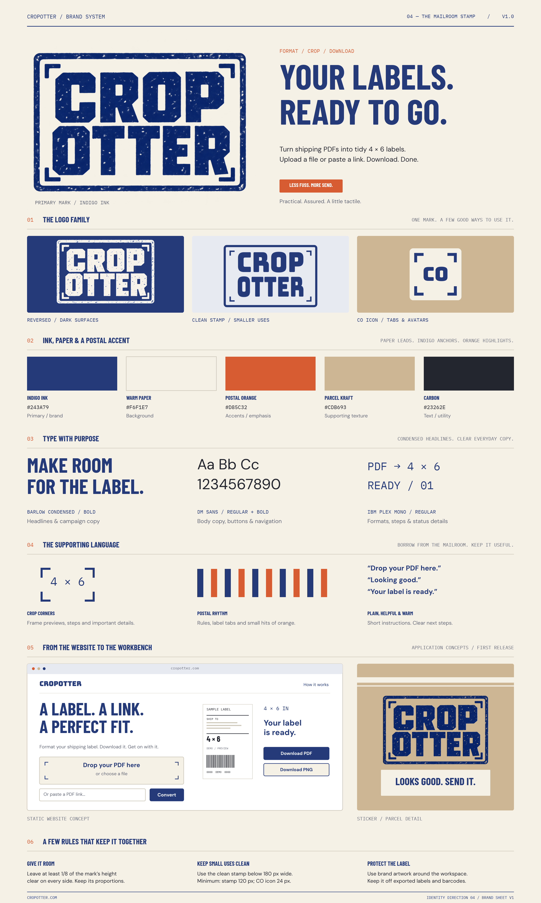

# The Mailroom Stamp

**CropOtter · Direction 04 · Approved brand system v1**

The identity borrows from the packing table: indigo ink, warm paper, crop corners, a tactile stamp, and a small flash of postal orange. The voice is plain, useful and warm. **Your labels. Ready to go.**

| Color         | Hex       | Use                                 |
| ------------- | --------- | ----------------------------------- |
| Indigo Ink    | `#243A79` | Main brand color, headings, buttons |
| Warm Paper    | `#F6F1E7` | Main background                     |
| Postal Orange | `#D85C32` | Accent rules and details            |
| Parcel Kraft  | `#CDB693` | Supporting surfaces                 |
| Carbon        | `#23262E` | Reading text                        |

Barlow Condensed Bold is the display face. DM Sans carries body copy and controls. IBM Plex Mono carries sizes, step numbers and utility copy. Bungee supplies the clean outlined logo companion. The website uses a darker orange for small text to preserve contrast.

The [full guide](Brand-Guide.txt), [design tokens](brand-tokens.json), [CSS tokens](brand-tokens.css), [editable Tesseract board](CropOtter-Brand-Sheet.tsrct), [authoring source](build_brand_sheet.py), and original [assets](assets/) are included. The board's website and packaging applications are concept illustrations; the implemented website is under `apps/web`.

Use the textured primary stamp for larger placements and the outlined SVG companions for smaller digital uses. Keep the proportions and at least one eighth of the mark's height clear around it. Suggested minimum widths: clean full stamp 120 px, compact CO icon 24 px; switch from texture below 180 px. **Keep all brand artwork off exported shipping labels and barcode quiet zones.**

Fonts are supplied under the included SIL Open Font License files. The repository cover can be regenerated with Python and fontTools: `python brand/build_repo_banner.py`. Website fonts and optimized web artwork live in `apps/web/public`.
