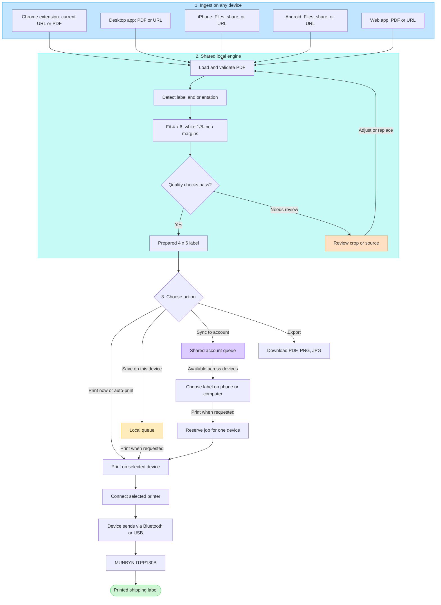
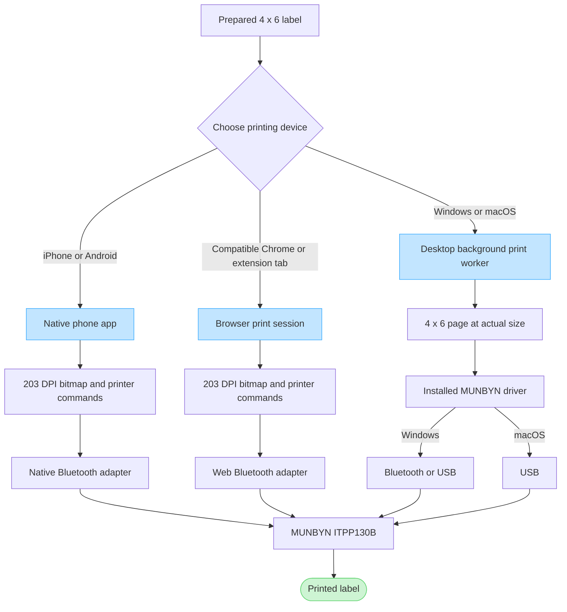

# crop/ship workflow diagrams

Proposed workflow as discussed with the user. Direct ITPP130B printing still requires hardware validation.

Rendered files: [workflow PNG](workflow.png), [workflow SVG](workflow.svg), [printer routes PNG](print-routes.png), [printer routes SVG](print-routes.svg). Editable Mermaid originals: [workflow](workflow.mmd), [printer routes](print-routes.mmd).

User experience: [user journey PNG](user-journey.png), [user journey SVG](user-journey.svg), [editable Mermaid source](user-journey.mmd). This view follows the user's actions and visible results: bring a label, send it to crop/ship, print now or save to My Labels, then peel, stick, and ship. It includes the optional auto-print path and picking up a saved label on another device.

## Ingest to a printed label

## Device-specific printing routes

## Reading the routes

- The cropping engine runs on the device that ingests the PDF or URL. Each shell shares the same engine; the diagram does not introduce a hosted conversion service.
- A prepared label is exactly 4 × 6 inches with at least 1/8 inch of white margin on every side. Ambiguous crops and poor source quality require review.
- Print now uses the current selected device. Auto-print is an explicit preference established after printer setup.
- A local queue stays on one device. The shared account queue syncs prepared PDF files and job metadata across signed-in devices. Files belong in account file storage; the database tracks their references, ownership, and job status.
- The cloud queue persists when all apps are closed. A shared job is reserved by one device before dispatch to limit accidental duplicate printing.
- The device printing needs access to the selected printer. The cloud queue does not itself have a Bluetooth connection.
- A desktop print worker can run with its window closed. Native phone background printing is a target subject to OS scheduling, permissions, printer availability, and hardware validation; keeping the phone app on screen is not an absolute architectural requirement. When execution is unavailable, the job remains queued.
- The browser route requires compatible Chrome, an active print context, and initial device permission. iPhone printing uses the native app. Desktop Chrome on Mac is distinct from the vendor's macOS USB-driver route.
- BLE routes use a calibrated raster and verified printer commands. Normal OS driver printing uses an exact-size rendered page through the installed vendor driver.
- The printed-label node represents the physical result. Successful software submission or BLE writes alone do not confirm that result. Uncertain sends pause for review and are not automatically replayed.

## Common journeys

1. Chrome extension → engine → direct browser Bluetooth → printer.
2. Chrome extension → engine → shared queue → iPhone or Android app → native Bluetooth → printer.
3. Desktop app → engine → vendor driver → Windows Bluetooth/USB or macOS USB → printer.
4. Phone app → engine → local or shared queue → print later from an available device.
5. Any ingest surface → engine → download cropped PDF, PNG, or JPG.

